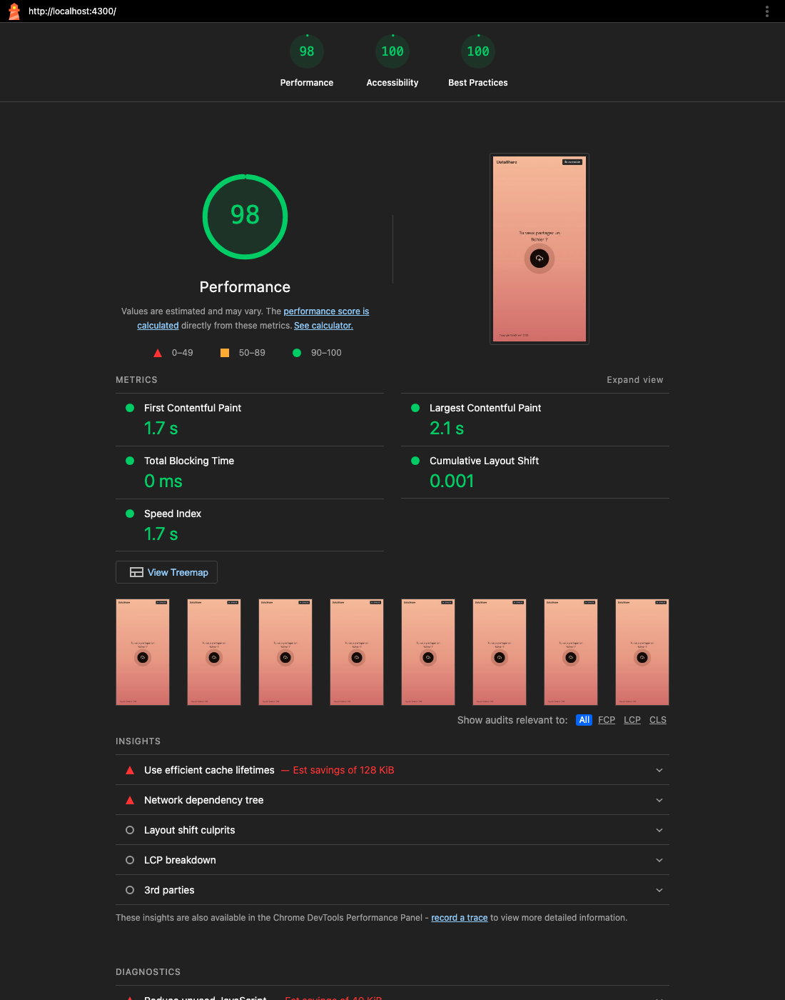

# PERF.md — Suivi de performance

Mesures du 2026-10-09, en local : MacBook (Apple Silicon), PostgreSQL 16 dans Docker (Colima), back lancé avec `./mvnw spring-boot:run`, front en build de production.
Résultats bruts : [`perf/results/`](perf/results/).

## Endpoints critiques et objectifs

| Endpoint | Pourquoi il est critique | Objectif (SLO) |
|---|---|---|
| `GET /api/v1/files` (historique, US05) | Page la plus consultée par les utilisateurs connectés, requête BDD + tags | p95 < 300 ms, 0 % d'erreur |
| `POST /api/v1/public/files/{token}/download` (US02) | Tout le trafic des destinataires, lecture disque + streaming | p95 < 500 ms pour 1 Mo, 0 % d'erreur |
| `POST /api/v1/files` (upload, US01) | Débit dépendant de la taille du fichier | Pas de chargement complet en mémoire (streaming) |

## Test de charge — k6

Script : [`perf/k6-critical-endpoints.js`](perf/k6-critical-endpoints.js)

```bash
# Prérequis : Postgres + back démarrés (voir README)
brew install k6            # ou : docker run --rm -i --network=host grafana/k6 run - < perf/k6-critical-endpoints.js
k6 run perf/k6-critical-endpoints.js
# → résumé dans le terminal + perf/results/k6-summary.{txt,json}
```

Le `setup()` crée un utilisateur et 25 fichiers (dont un de 1 Mo), puis deux scénarios tournent **en parallèle** pendant 70 s :

| Scénario | Charge | Action par itération |
|---|---|---|
| `history` | montée à 20 utilisateurs virtuels (20 s), plateau 40 s, descente 10 s | `GET /files?includeExpired=true` (25 fichiers avec tags), pause 1 s |
| `download` | 10 utilisateurs virtuels constants | téléchargement public du fichier de 1 Mo, pause 1 s |

### Résultats ([k6-summary.txt](perf/results/k6-summary.txt))

| Métrique | `history` | `download` (1 Mo) |
|---|---|---|
| Requêtes | 1 105 | 700 |
| Médiane | 7,7 ms | 8,9 ms |
| p90 | 9,8 ms | 12,5 ms |
| **p95** | **10,6 ms** ✅ (seuil 300 ms) | **13,4 ms** ✅ (seuil 500 ms) |
| Max | 26,9 ms | 16,6 ms |

- **1 832 requêtes**, **0 % d'erreur** (seuil < 1 %), 3 610 checks OK sur 3 610 (statut 200, 25 fichiers renvoyés, 1 Mo reçu).
- Débit descendant : **744 Mo en 72 s (≈ 10 Mo/s)**, imposé par la pause de 1 s des utilisateurs virtuels, pas par le serveur.

### Interprétation

- Les deux endpoints restent **20 à 30 fois sous leurs seuils** avec 30 utilisateurs simultanés : la marge est large pour un MVP.
- L'historique tient bien la charge grâce à l'`@EntityGraph` sur les tags : **une seule requête SQL** par appel au lieu d'une par fichier (N+1). C'est aussi ce qui corrige la `LazyInitializationException` constatée au départ.
- Le téléchargement est stable (écart max/médiane faible) : le fichier est lu en **streaming** (`InputStreamResource`), la mémoire ne dépend pas de la taille du fichier.
- Le seul pic (369 ms, dans le `setup`) correspond au premier appel : préchauffage de la JVM et premier hachage BCrypt à la connexion (coût 12, volontairement lent).
- Limites : test en local, réseau sans latence, petit volume en base. À rejouer sur l'environnement cible avec plus de données (milliers de fichiers par utilisateur → pagination de `GET /files` à prévoir).

## Métriques serveur — Spring Boot Actuator

Exposées par `spring-boot-starter-actuator` : `/actuator/health` (public) et `/actuator/metrics` (**JWT requis**).
Les percentiles p50, p95 et p99 de `http.server.requests` sont activés dans `application.yml`.

```bash
curl http://localhost:8080/actuator/health
curl -H "Authorization: Bearer <jwt>" "http://localhost:8080/actuator/metrics/http.server.requests?tag=uri:/api/v1/files"
curl -H "Authorization: Bearer <jwt>" http://localhost:8080/actuator/metrics/datashare.upload.size
```

Relevé juste après le test k6 ([server-metrics.txt](perf/results/server-metrics.txt)) :

| Métrique | Valeur |
|---|---|
| `http.server.requests` — `GET /api/v1/files` | 1 105 requêtes, **7,2 ms** en moyenne côté serveur, max 26 ms |
| `http.server.requests` — download | 700 requêtes, **7,6 ms** en moyenne, max 15 ms |
| `datashare.upload.size` (métrique applicative ajoutée dans `FileService`) | 25 fichiers, 41 Ko en moyenne, max 1 Mo |
| `jvm.memory.used` (heap) | **81 Mo** après le test (objectif < 512 Mo) |
| `process.cpu.usage` | 0,4 % au repos après le test |

Le temps côté serveur (≈ 7 ms) est proche du temps mesuré par k6 (≈ 8-9 ms) : il n'y a presque pas d'attente réseau ou de file d'attente.

**Taille des fichiers dans les logs** : chaque upload produit une ligne `INFO`, exploitable par un outil de logs ([extrait](perf/results/server-log-sample.txt)) :

```
INFO ... com.datashare.file.FileService : Upload file id=58 size=10 bytes anonymous=false
```

## Budget de performance front

Budgets définis dans `frontend/angular.json` (configuration `production`) :

| Budget | Avertissement | Erreur | Mesuré | Statut |
|---|---|---|---|---|
| Bundle initial (brut) | 500 kB | 1 MB | **335 kB** (93 kB transférés en gzip) | ✅ |
| CSS par composant | 4 kB | — | < 4 kB (aucun avertissement) | ✅ |

Détail ([bundle-budget.txt](perf/results/bundle-budget.txt)) : `main` 294 kB, `polyfills` 35 kB, `styles` 6 kB. Chaque page est un **chunk chargé à la demande** (lazy loading) : `history` 11 kB, `shell` 6 kB, `download` 5 kB, `register` 4 kB, `login` 3 kB, `home` 2 kB.

```bash
cd frontend && npx ng build      # affiche le tableau des chunks et échoue si le budget « error » est dépassé
```

### Performance navigateur — Lighthouse

Lighthouse 13.5.0 sur le build de production (profil **mobile** simulé, connexion 4G lente, CPU ralenti 4×) :

```bash
cd frontend && npx ng build && npx serve -s dist/datashare/browser -l 4300
npx lighthouse http://localhost:4300/ --view
```

| Page | Performance | Accessibilité | Bonnes pratiques | FCP | LCP | TBT | CLS | Poids total |
|---|---|---|---|---|---|---|---|---|
| Accueil `/` | **98** | **100** | **100** | 1,7 s | 2,1 s | 0 ms | 0,001 | 193 Ko |
| Connexion `/login` | **98** | **100** | **100** | 1,7 s | 2,1 s | 0 ms | 0 | 188 Ko |
| Inscription `/register` | **98** | **100** | **100** | 1,7 s | 2,1 s | 0 ms | 0 | 188 Ko |



Rapports HTML complets : [accueil](perf/results/lighthouse-home.report.html) · [connexion](perf/results/lighthouse-login.report.html) · [inscription](perf/results/lighthouse-register.report.html).

Interprétation :
- Toutes les Core Web Vitals sont dans le vert (LCP < 2,5 s, CLS < 0,1, TBT nul), même en mobile bridé.
- Le premier audit d'accessibilité donnait 95 sur `/login` : l'orange du Figma (#E07A38) n'offrait qu'un contraste de 3:1. Il a été assombri en **#AD5016** (≥ 4,5:1, niveau AA), de même que le texte des alertes et le copyright posé sur le dégradé.
- Pistes restantes signalées par Lighthouse : en-têtes de cache longs sur les fichiers hachés (à configurer sur le serveur web de production) et ~40 Ko de JavaScript non utilisé au premier chargement.

## Optimisations en place

- **Lazy loading** des routes Angular (une page = un chunk).
- **Signals + `OnPush`** : détection de changements ciblée.
- **Build esbuild** (`@angular/build:application`) avec hachage des fichiers en production.
- **`@EntityGraph`** sur l'historique : plus de requêtes N+1 sur les tags.
- **Index BDD** sur `owner_id`, `expires_at` et `public_token` (UNIQUE).
- **Streaming** des téléchargements (`InputStreamResource`) et des uploads (`MultipartFile.getInputStream()`).
- **`open-in-view: false`** : aucune requête SQL tardive pendant la sérialisation.

## À suivre (roadmap)

- Pagination de `GET /files` quand un utilisateur aura des centaines de fichiers.
- Export Prometheus (`micrometer-registry-prometheus`) + tableau de bord Grafana : latence, débit, `datashare.upload.size`, espace disque de `storage/`.
- Compression HTTP (`server.compression.enabled=true`) et `Cache-Control` longs sur les fichiers hachés du front.
- Rejouer le test k6 à chaque version majeure (Spring Boot, Angular) et le brancher en CI avec les mêmes seuils.
