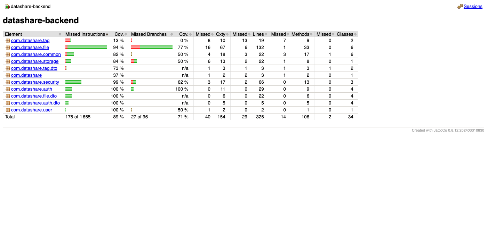
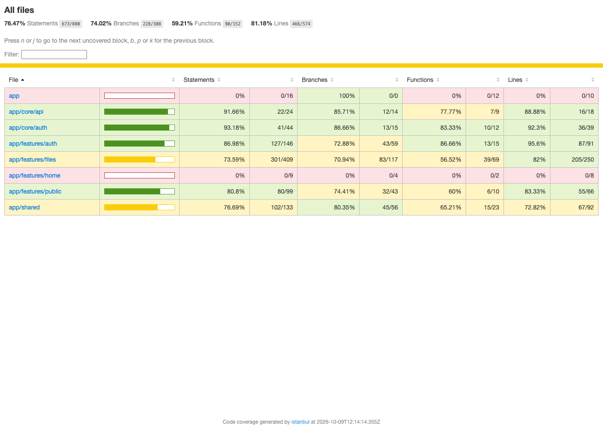

# TESTING.md — Plan de tests

## Vue d'ensemble

| Type | Techno | Emplacement | Objectif |
|---|---|---|---|
| Unit back | JUnit 5 + Mockito + AssertJ | `backend/src/test/java/**/*Test.java` (hors `*IntegrationTest`) | Services + policies isolés |
| Intégration back | @SpringBootTest + MockMvc + Testcontainers (Postgres 16) | `backend/src/test/java/**/*IntegrationTest.java` | Flux HTTP réels de bout en bout, vraie BDD |
| Unit front | Vitest (builder `@angular/build:unit-test`, jsdom) + `HttpTestingController` | `frontend/src/**/*.spec.ts` | Services / stores / guards |
| E2E | Cypress | `frontend/cypress/e2e/*.cy.ts` | 2-3 scénarios critiques |

## Critères d'acceptation

- Tous les tests **passent en CI** avant merge sur `main`.
- **Couverture ≥ 70 %** (JaCoCo pour le back, couverture v8 de Vitest pour le front).
- Chaque US du MVP possède au moins **un test unitaire** et **un test d'intégration ou E2E**.
- Toute correction de bug est accompagnée d'un test qui échoue avant la correction.

## Scénarios critiques couverts par les tests d'intégration back

`FileFlowIntegrationTest` :
1. **US01 + US05 + US06 + US02** — upload → list → public meta → download → delete → 404 + métadonnées supprimées en BDD
2. **US09** — upload avec mot de passe → mauvais mdp = 403 → bon mdp = 200
3. **US07** — upload anonyme sans header Authorization
4. **US01** — extension bloquée (`.exe`) → 400
5. **US08** — upload avec tags (doublons ignorés) → tag > 30 car. = 400 → remplacement des tags → un autre utilisateur = 404
6. **US10** — fichier expiré : lien = 410 → job de purge → fichier et métadonnées supprimés, lien = 404

`AuthIntegrationTest` :
7. **US03 + US04** — register → login → `/me` (sans token = 401)
8. **US03** — email dupliqué → 409
9. **US03** — email invalide → 400
10. **US04** — mauvais mot de passe → 401

## Tests unitaires front (37 tests, Vitest)

| Fichier | Couvre |
|---|---|
| `auth.service.spec.ts` | US03 / US04 — inscription sans token, login, logout |
| `jwt.interceptor.spec.ts` | US04 — en-tête `Bearer`, aucun jeton en anonyme, déconnexion sur 401, guard des routes privées |
| `login.component.spec.ts` | US04 — connexion puis redirection vers l'espace, message sur identifiants invalides |
| `register.component.spec.ts` | US03 — email valide, mot de passe ≥ 8, confirmation identique, email déjà utilisé (409) |
| `upload-modal.component.spec.ts` | US01 / US07 / US09 / US10 — mot de passe ≥ 6, expiration ≤ 7 j, fichier > 1 Go et extension refusés côté client, envoi des tags, endpoint anonyme, lien affiché après l'envoi |
| `upload-rules.spec.ts` | US01 — règles partagées (taille, extensions, durée) |
| `history.component.spec.ts` | US05 / US06 / US08 — non expirés par défaut, dates affichées, confirmation de suppression, filtre et édition des tags |
| `download.component.spec.ts` | US02 — métadonnées avant téléchargement, encadrés « dans N jours » / « demain », mot de passe requis, liens expiré (410) et invalide (404) |
| `tag-input.component.spec.ts` | US08 — doublons refusés, 30 caractères max, retrait d'un tag |

## Scénarios E2E (Cypress)

1. **Inscription + upload (avec tag) + partage** (`01-register-upload-share.cy.ts`) — un user crée un compte, upload un fichier, copie le lien, l'ouvre en navigation privée.
2. **Upload anonyme + téléchargement protégé par mot de passe** (`02-anonymous-password-download.cy.ts`) — un visiteur envoie un fichier avec mdp, un autre le télécharge après avoir saisi le bon mdp.
3. **Suppression** (`03-delete.cy.ts`) — un user supprime un fichier, l'ancien lien renvoie 404.

## Instructions d'exécution

### Back
```bash
cd backend
./mvnw verify          # unit + intégration + rapport JaCoCo dans target/site/jacoco/
open target/site/jacoco/index.html
```

### Front unit
```bash
cd frontend
npm test                       # Vitest en watch + couverture
npm test -- --watch=false      # exécution unique (CI)
open coverage/datashare/index.html
```

### E2E
```bash
cd frontend
npm run e2e            # ouvre Cypress (mode interactif)
npm run e2e:run        # exécution headless (CI)
```
Prérequis : Postgres, back-end (`:8080`) et front-end (`:4200`) démarrés.
Depuis le terminal intégré de VS Code, lancer avec `env -u ELECTRON_RUN_AS_NODE npm run e2e:run`.

## Résultats (2026-10-09)

| Suite | Commande | Résultat |
|---|---|---|
| Back — unitaires + intégration (Testcontainers) | `cd backend && ./mvnw verify` | **25 / 25** ✅ |
| Front — unitaires (Vitest) | `cd frontend && npm test -- --watch=false` | **37 / 37** ✅ |
| E2E (Cypress 16) | `cd frontend && npm run e2e:run` | **3 / 3** scénarios ✅ |

## Rapport de couverture

| Périmètre | Outil | Lignes | Instructions | Branches | Objectif 70 % |
|---|---|---|---|---|---|
| Back | JaCoCo | **91 %** (296/325) | **89 %** | 71 % | ✅ |
| Front (tout `src/app`, pas seulement les fichiers testés) | Vitest + v8 | **81 %** (466/574) | **76 %** | 74 % | ✅ |

- **Back** : rapport HTML sous `backend/target/site/jacoco/index.html` (après `./mvnw verify`).
- **Front** : rapport HTML sous `frontend/coverage/datashare/index.html` (après `npm test`).
- Parties non couvertes assumées : CRUD `/api/v1/tags` (le front gère les tags par nom via `/files`), composants d'amorçage (`app.config`, routes) et page d'accueil, couverts par les tests E2E.




