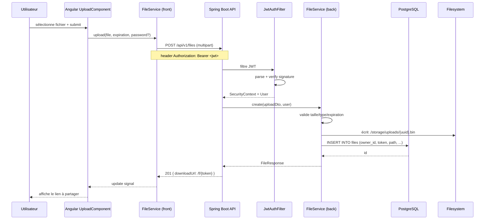

# Architecture de la solution

## Vue d'ensemble

```mermaid
flowchart TB
    subgraph Client["Client (navigateur)"]
        A[Angular SPA<br/>Standalone components + Signals]
    end

    subgraph Server["Serveur applicatif"]
        B[Spring Boot 3<br/>API REST /api/v1/*]
        C[Spring Security<br/>Filtre JWT]
        D[Service Layer]
        E[Repository JPA]
        F[Scheduler<br/>@Scheduled purge quotidienne]
        G[FileStorageService<br/>abstraction stockage]
    end

    subgraph Data["Persistance"]
        H[(PostgreSQL 16<br/>users / files / tags / download_events)]
        I[/Filesystem local<br/>./storage/uploads//]
    end

    A -- HTTPS + JWT Bearer --> B
    B --> C --> D --> E --> H
    D --> G --> I
    F --> D
```

## Couches back

| Couche | Rôle | Exemple |
|---|---|---|
| **Controller** | Reçoit HTTP, valide DTO, renvoie ResponseEntity JSON | `AuthController`, `FileController` |
| **Service** | Logique métier (règles de gestion des US) | `AuthService`, `FileService` |
| **Repository** | Accès BDD via Spring Data JPA | `UserRepository`, `FileRepository` |
| **Entity** | Mapping JPA table ↔ objet Java | `User`, `FileEntity`, `Tag` |
| **DTO** | Transport HTTP (jamais d'entity exposée) | `RegisterRequest`, `FileResponse` |
| **Security** | Filtre JWT + `SecurityFilterChain` | `JwtAuthFilter`, `SecurityConfig` |
| **Storage** | Abstraction filesystem/S3 | `FileStorageService` (interface), `LocalFileStorage` |
| **Scheduler** | Tâches planifiées (purge US10) | `FileExpirationJob` |

## Couches front (Angular)

```
frontend/src/app/
├── core/                       # singleton services & guards
│   ├── auth/
│   │   ├── auth.service.ts
│   │   ├── auth.guard.ts
│   │   └── jwt.interceptor.ts
│   └── api/                    # clients HTTP typés
│       ├── auth.api.ts
│       └── file.api.ts
├── features/                   # une feature = un module fonctionnel
│   ├── auth/
│   │   ├── login.component.ts
│   │   └── register.component.ts
│   ├── files/
│   │   ├── upload.component.ts
│   │   ├── history.component.ts
│   │   └── file-download.component.ts (public)
│   └── shell/                  # layout principal
├── shared/                     # composants UI réutilisables
└── app.routes.ts
```

## Flux d'une requête (upload de fichier)



## Sécurité

- **HTTPS** obligatoire en prod (via reverse proxy Caddy/Nginx).
- **JWT** signé HS256, expiration 24 h, stocké en `localStorage` côté front (ok pour MVP, roadmap : cookie httpOnly).
- **BCrypt** (strength 12) pour les mots de passe user ET les mots de passe de fichier.
- **CORS** restreint à l'origine du front (`http://localhost:4200` en dev).
- **Filtre extensions** : blocklist `.exe`, `.bat`, `.cmd`, `.sh`, `.msi`, `.ps1`, `.vbs`.
- **Taille max** : 1 GB (`multipart.maxFileSize=1GB`).
- **Rate limiting** sur `/api/auth/*` (bucket4j, roadmap).

## Déploiement (roadmap)

- Docker Compose local : Postgres + backend + frontend nginx
- Prod : Docker + reverse proxy Caddy (HTTPS auto Let's Encrypt)
- CI : GitHub Actions → `mvn verify` + `ng test --code-coverage` + `docker build`
