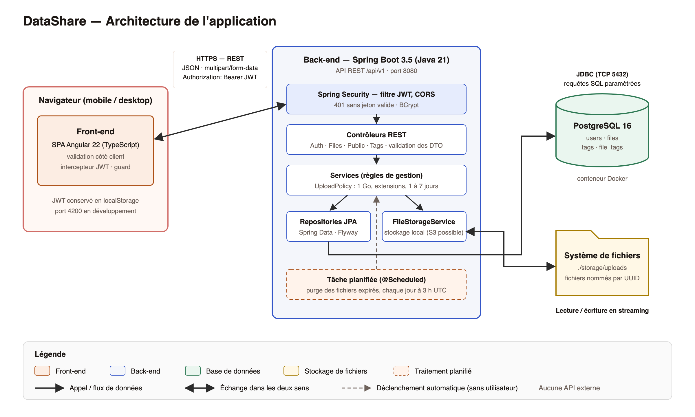

# Architecture de la solution

## Vue d'ensemble



Source modifiable du schéma : [`architecture.svg`](architecture.svg).

| Brique | Technologie | Rôle |
|---|---|---|
| **Client** | Navigateur (mobile ou desktop) | Affiche la SPA, conserve le JWT en `localStorage` |
| **Front-end** | Angular 22 (composants standalone, signals) — port 4200 en dev | Interface, validation côté client, appels REST |
| **Back-end** | Spring Boot 3.5 / Java 21 — port 8080 | API REST `/api/v1/*`, règles de gestion, sécurité |
| **Base de données** | PostgreSQL 16 (Docker) — port 5432 | Tables `users`, `files`, `tags`, `file_tags` (schéma géré par Flyway) |
| **Stockage de fichiers** | Système de fichiers local `./storage/uploads` | Contenu des fichiers, nommés par UUID |
| **Tâche planifiée** | `@Scheduled` (dans le back) — tous les jours à 3 h UTC | Purge des fichiers expirés (blob + ligne en base) |

Flux entre les briques :

| De → vers | Protocole | Contenu | Sécurisation |
|---|---|---|---|
| Navigateur → Front | HTTP(S) | Fichiers statiques de la SPA | HTTPS en production (reverse proxy) |
| Front → Back | HTTP(S) REST, JSON et `multipart/form-data` | Authentification, upload, historique, tags, téléchargement | En-tête `Authorization: Bearer <JWT>` sur les routes privées ; CORS limité à l'origine du front |
| Back → PostgreSQL | JDBC (TCP 5432) | Métadonnées, comptes, tags | Identifiants en variables d'environnement, requêtes paramétrées (JPA) |
| Back → Stockage | Accès disque | Contenu des fichiers, en streaming | Chemin vérifié (pas de sortie du dossier racine), nom = UUID |
| Tâche planifiée → Base + Stockage | Interne | Suppression des fichiers expirés | — |

Il n'y a aucune API externe.

## Couches back

| Couche | Rôle | Exemple |
|---|---|---|
| **Controller** | Reçoit HTTP, valide les DTO, renvoie du JSON | `AuthController`, `FileController`, `PublicFileController`, `TagController` |
| **Service** | Logique métier (règles de gestion des US) | `AuthService`, `FileService`, `TagService` |
| **Policy** | Contrôles d'upload (taille, extensions, expiration, mot de passe) | `UploadPolicy` |
| **Repository** | Accès BDD via Spring Data JPA | `UserRepository`, `FileRepository`, `TagRepository` |
| **Entity** | Mapping JPA table ↔ objet Java | `User`, `FileEntity`, `Tag` |
| **DTO** | Transport HTTP (jamais d'entité exposée) | `RegisterRequest`, `FileResponse`, `PublicFileMeta` |
| **Security** | Filtre JWT + `SecurityFilterChain` | `JwtAuthFilter`, `JwtService`, `SecurityConfig` |
| **Storage** | Abstraction du stockage (local aujourd'hui, S3 possible) | `FileStorageService` (interface), `LocalFileStorage` |
| **Scheduler** | Tâche planifiée de purge (US10) | `FileExpirationJob` |
| **Erreurs** | Réponses d'erreur homogènes (400, 401, 403, 404, 409, 410) | `GlobalExceptionHandler` |

## Couches front (Angular)

```
frontend/src/app/
├── app.config.ts               # providers (router, HttpClient + intercepteur JWT)
├── app.routes.ts               # routes, chargées à la demande (lazy loading)
├── core/
│   ├── auth/
│   │   ├── auth.service.ts     # login, register, logout, état de session (signals)
│   │   ├── auth.guard.ts       # protège /files
│   │   └── jwt.interceptor.ts  # ajoute le Bearer, déconnecte sur 401
│   └── api/
│       └── file.api.ts         # client HTTP typé (fichiers, tags, lien public)
├── features/
│   ├── home/home.component.ts              # accueil + bouton d'upload
│   ├── auth/login.component.ts             # US04
│   ├── auth/register.component.ts          # US03
│   ├── files/upload-modal.component.ts     # US01 / US07 / US09 / US10
│   ├── files/upload-rules.ts               # règles d'upload côté client
│   ├── files/history.component.ts          # US05 / US06 / US08
│   └── public/download.component.ts        # US02
└── shared/
    ├── public-layout.component.ts  # gabarit des pages publiques (en-tête, pied de page)
    ├── shell.component.ts          # gabarit de l'espace connecté (sidebar / tiroir mobile)
    ├── tag-input.component.ts      # saisie de tags
    ├── icon.component.ts           # icônes SVG
    └── format.ts                   # tailles, durées, téléchargement d'un blob
```

## Flux d'une requête : upload d'un fichier par un utilisateur connecté

1. L'utilisateur choisit un fichier ; `UploadModalComponent` vérifie côté client la taille (≤ 1 Go), l'extension, le mot de passe (≥ 6 caractères) et l'expiration (1 à 7 jours).
2. `FileApi.upload()` envoie `POST /api/v1/files` en `multipart/form-data` ; `jwtInterceptor` ajoute `Authorization: Bearer <jwt>`.
3. `JwtAuthFilter` vérifie la signature et l'expiration du jeton, charge l'utilisateur et renseigne le `SecurityContext` (sinon `401`).
4. `FileController` appelle `FileService.upload()` ; `UploadPolicy` refait les mêmes contrôles côté serveur (`400` en cas d'échec).
5. `LocalFileStorage` écrit le contenu en streaming dans `./storage/uploads/<uuid>`.
6. `FileService` crée les tags manquants puis insère la ligne `files` (jeton public UUID, date d'expiration, hash BCrypt du mot de passe éventuel).
7. L'API répond `201` avec un `FileResponse` ; la modale affiche le lien de partage `/d/<publicToken>`.

Le téléchargement public suit le chemin inverse : `GET /api/v1/public/files/{token}/meta` (métadonnées, `404` si inconnu, `410` si expiré) puis `POST …/download` avec le mot de passe éventuel (`403` s'il est faux).

## Sécurité

- **HTTPS** obligatoire en production (reverse proxy).
- **JWT** signé en HMAC-SHA (HS384 avec le secret de développement ; l'algorithme dépend de la longueur de `JWT_SECRET`, 32 caractères minimum), expiration 24 h, stocké en `localStorage` (acceptable pour le MVP, évolution : cookie `httpOnly`).
- **BCrypt** (coût 12) pour les mots de passe des comptes et ceux des fichiers.
- **CORS** restreint à l'origine du front (`http://localhost:4200` en dev).
- **Extensions interdites** : `.exe .bat .cmd .com .cpl .msi .ps1 .sh .vbs .js .jar .scr`.
- **Taille maximale** : 1 Go, contrôlée côté client, par Spring (`max-file-size`), par `UploadPolicy` et par une contrainte SQL.
- **Autorisations** : pas de rôles ; chaque requête privée est filtrée sur le propriétaire (`owner_id`), les liens publics reposent sur un UUID non prédictible.
- Détail des menaces, scans et décisions : [SECURITY.md](../SECURITY.md).

## Déploiement

- En local : `docker compose up -d` (PostgreSQL), `./mvnw spring-boot:run`, `npm start` (voir le [README](../README.md)).
- Cible (pas encore en place) : images Docker du back et du front (nginx), reverse proxy HTTPS, CI qui lance `./mvnw verify`, `npm test` et les tests E2E.
