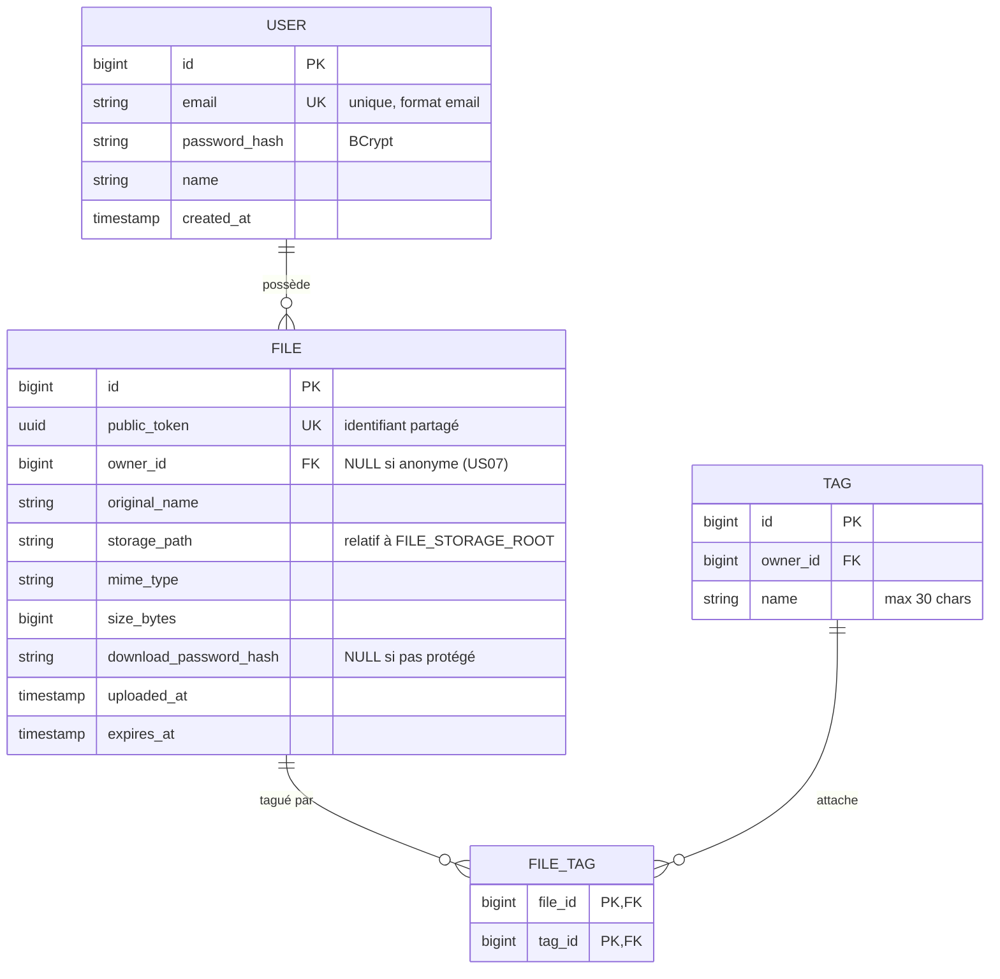

# Modèle de données

## MCD

## Tables PostgreSQL

### `users`

| Colonne | Type | Contraintes |
|---|---|---|
| `id` | BIGSERIAL | PK |
| `email` | VARCHAR(255) | UNIQUE, NOT NULL |
| `password_hash` | VARCHAR(72) | NOT NULL (BCrypt = 60 chars, marge) |
| `name` | VARCHAR(100) | NULL |
| `created_at` | TIMESTAMPTZ | NOT NULL DEFAULT now() |

Index : `idx_users_email` (déjà via UNIQUE).

### `files`

| Colonne | Type | Contraintes |
|---|---|---|
| `id` | BIGSERIAL | PK |
| `public_token` | UUID | UNIQUE, NOT NULL, DEFAULT gen_random_uuid() |
| `owner_id` | BIGINT | FK users(id) ON DELETE CASCADE, NULL (anon possible pour US07) |
| `original_name` | VARCHAR(255) | NOT NULL |
| `storage_path` | VARCHAR(500) | NOT NULL |
| `mime_type` | VARCHAR(100) | NOT NULL |
| `size_bytes` | BIGINT | NOT NULL, CHECK <= 1_073_741_824 (1 GB) |
| `download_password_hash` | VARCHAR(72) | NULL |
| `uploaded_at` | TIMESTAMPTZ | NOT NULL DEFAULT now() |
| `expires_at` | TIMESTAMPTZ | NOT NULL, CHECK expires_at > uploaded_at |

Index :
- `idx_files_owner` sur `owner_id`
- `idx_files_expires` sur `expires_at` (utilisé par le job de purge)
- `idx_files_token` (via UNIQUE)

### `tags`

| Colonne | Type | Contraintes |
|---|---|---|
| `id` | BIGSERIAL | PK |
| `owner_id` | BIGINT | FK users(id) ON DELETE CASCADE, NOT NULL |
| `name` | VARCHAR(30) | NOT NULL |

Contrainte : `UNIQUE(owner_id, LOWER(name))` — pas de doublon de tag chez un user.

### `file_tags`

Table de jointure many-to-many.

| Colonne | Type | Contraintes |
|---|---|---|
| `file_id` | BIGINT | FK files(id) ON DELETE CASCADE, PK partiel |
| `tag_id` | BIGINT | FK tags(id) ON DELETE CASCADE, PK partiel |

## Règles dérivées des US

| Règle | Colonnes impliquées |
|---|---|
| Email unique (US03) | `users.email UNIQUE` |
| Password hashé (US03) | `users.password_hash` BCrypt |
| JWT stateless (US04) | Pas de table token — payload JWT contient `userId` |
| Expiration 7j max (US01) | Check applicatif + `expires_at` calculé au serveur |
| Fichier lié à user (US01) | `files.owner_id` NOT NULL en mode connecté |
| Historique (US05) | Requête `SELECT * FROM files WHERE owner_id=? ORDER BY uploaded_at DESC` (tags chargés en une requête via `@EntityGraph`) |
| Suppression physique (US06) | `DELETE` de la ligne `files` (cascade sur `file_tags`) + suppression du blob |
| Mot de passe fichier (US09) | `download_password_hash` BCrypt |
| Purge auto (US10) | Job `@Scheduled(cron="0 0 3 * * *")` → blob + ligne supprimés WHERE expires_at < now() |
| Tags 0..N (US08) | Table de jointure `file_tags` ; tags saisis en texte libre, créés à la volée, doublons ignorés (casse comprise) |

## Choix de conception

- **UUID pour `public_token`** : non prédictible (spec US02) — 122 bits d'entropie, impossible à brute-forcer.
- **Suppression définitive** (migration V3) : les specs US01/US06/US10 exigent la suppression du fichier *et* de ses métadonnées. Un fichier expiré reste visible (onglet « Expiré ») jusqu'au passage de la purge quotidienne.
- **`owner_id` NULL** possible : ouvre la porte à US07 (upload anonyme) sans refonte du schéma.
- **Pas de table `download_events`** (supprimée en V2) : la traçabilité des téléchargements n'est pas demandée dans le MVP.
